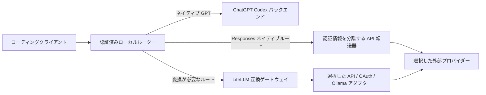

# Codex Router

[English](README.md) · [简体中文](README.zh-CN.md) · 日本語

一つのローカルルーターを使って、Codex やほかのコーディングクライアントから外部モデルを利用できます。
プロバイダーの認証情報をローカルに保存し、複数のクライアントで一つの構成を共有します。
有効な ChatGPT ログインがあれば、ネイティブ GPT も利用できます。

[インストール](#インストール) · [初回の利用](#初回の利用) ·
[プロバイダー](#プロバイダーとモデル) · [よく使うコマンド](#よく使うコマンド) · [ドキュメント](#ドキュメント)

## 対応クライアント

| クライアント | 接続方法 |
| --- | --- |
| Codex App / CLI | モデル選択メニューにネイティブモデルと外部モデルを表示。Linux は CLI に対応 |
| DeepSeek Harness | 設定ファイルにプロバイダールートを登録 |
| Gemini CLI | エンドポイント、キー、既定モデルの環境変数ブロックを管理 |
| Cursor Agent / Cursor App | Agent はローカルランチャー、App BYOK は専用キー付きの公開 HTTPS 入口 |
| Claude Code | `claude-router` ランチャーからローカル Messages アダプターに接続 |
| OpenClaw | Responses プロバイダーを登録 |
| opencode、pi、omp、Command Code、Hermes Agent | 既存クライアントにプロバイダー設定を書き込み |

Control Center で接続、モデルの表示、使用量、サービスの状態を管理します。
macOS はネイティブのメニューバーホストと埋め込み Electron ウィンドウ、
Windows と Linux は Electron ウィンドウとトレイを使います。

画像、検索、サブエージェントの機能は選択したモデルルートによって異なります。
追加のプロバイダー呼び出しや利用枠を使う機能もあります。
詳しくは [Codex ガイド](docs/ja/CODEX.md)と[クライアントガイド](docs/ja/COMPATIBLE-APPS.md)をご覧ください。

## インストール

### 必要な環境

- 既定の Codex 構成には Codex App または CLI。ほかの接続先を使う場合はそのクライアント。
- Node.js 22.19+。保守中の Node.js 24 LTS リリースを推奨します。
- 管理されたソースチェックアウトのインストール、更新、ロールバックには Git。
- 既定の互換レイヤーを有効にしたソースインストールには `uv`、
  または `venv` 付き Python 3.10+。
  [互換レイヤーを明示的に無効化](docs/ja/compatibility-layer.md)すると Python のインストールと検査を省略します。
  Responses モデルだけを選んだ場合も、インストール方針は保存済みの互換レイヤー設定に従います。
  Homebrew は formula に定義された Python 依存関係をインストールします。
- Windows は PowerShell の `FullLanguage` モードと、`Add-Type` を許可するシステムポリシー。
- macOS のデスクトップアプリをローカルでビルドする場合はフル版 Xcode。

認証情報はセットアップ中のローカル入力画面で入力します。
通常のセットアップでは、明示的に指定した場合に推論のライブテストを実行します。

### 対話式ソースインストール

**macOS / Linux — ターミナル**

```sh
curl -fsSL https://raw.githubusercontent.com/duolahypercho/codex-router/main/install.sh \
  | sh -s -- --target codex --guided --with-tray
```

**Windows — PowerShell**

```powershell
$installer = Join-Path $env:TEMP "codex-router-install.ps1"
Invoke-WebRequest https://raw.githubusercontent.com/duolahypercho/codex-router/main/install.ps1 -OutFile $installer
powershell.exe -NoProfile -ExecutionPolicy Bypass -File $installer -Target codex -Guided -WithTray
```

ルーターサービスとデスクトップアプリをインストールします。
ルーターだけを使う場合は、トレイ引数を `--no-tray`（macOS/Linux）または `-NoTray`（Windows）に置き換えます。
macOS でフル版 Xcode が見つからない場合は、デスクトップアプリを省略して案内を表示します。

スクリプトを先に確認する場合は、リポジトリをクローンしてローカルのインストーラーを実行します。
[インストール、プロキシ、移行](docs/ja/INSTALL.md)に手順があります。

### Homebrew — ルーターと CLI

```sh
brew tap duolahypercho/codex-router https://github.com/duolahypercho/codex-router
brew install codex-router
codex-router setup --guided
```

デスクトップアプリ、トレイ、macOS ウィジェットを利用する場合はソースインストーラーを使います。
Homebrew では以下の保守操作を `codex-router <command>` で実行し、
更新には `brew upgrade codex-router` を使います。
コマンドの対応と削除手順は [Homebrew の説明](docs/ja/INSTALL.md#homebrew-router-and-cli-only)をご覧ください。

## 初回の利用

1. プロバイダーの設定を完了します。カタログからモデルを選択してから表示されるプロバイダーもあります。
2. インストール済みソースディレクトリで診断を実行し、`FAIL` を解消します。
   macOS/Linux は `./bin/model-router codex doctor`、
   Windows は `.\model-router.ps1 codex doctor` を使います。
3. Codex を完全に終了して開き直し、新しいタスクでモデルを選択します。
   Codex は起動時にルーターのモデルカタログを読み込みます。
4. **Codex Router** を開くと Control Center が表示されます。
   ウィンドウを閉じた後は、トレイまたはメニューバーから開き直せます。

モデルが見つからない場合は、プロバイダーの選択、認証、モデルの表示設定を確認します。
[外部モデルの表示に関する診断](docs/ja/TROUBLESHOOTING.md#external-models-are-missing-from-the-picker)を参照してください。
ネイティブ GPT には利用可能な ChatGPT ログインが必要です。

エージェントにインストールを任せる場合はリポジトリのリンクを渡し、
[AGENTS.md](https://github.com/duolahypercho/codex-router/blob/main/AGENTS.md)に従って
既存設定とログインを保ち、選択したプロバイダーを設定し、診断を実行するよう依頼します。
最後の Codex 再起動は利用者が行います。

## プロバイダーとモデル

Anthropic、Kimi、DeepSeek、xAI、Z.ai、Qwen、MiniMax、Meta、
OpenRouter、GitHub Copilot などに対応します。
利用できるモデルはプロバイダー、地域、アカウント権限、ローカル設定によって決まります。

macOS/Linux のソースディレクトリでの例：

```sh
./bin/model-router codex provider-key deepseek set
./bin/model-router codex providers enable deepseek
./bin/model-router codex providers
```

Windows は `./bin/model-router codex` を `.\model-router.ps1 codex` に置き換えます。
モデルを事前登録しないプロバイダーでは、macOS/Linux の `./bin/curate-models PROVIDER`、
Windows の `.\codex-router.ps1 curate-models PROVIDER` で使うモデルを選択します。

- API、チャット契約、コーディング契約、地域別プラットフォームはそれぞれの権限と請求に従います。
- ローカルに追加したモデルは、実際のクライアントでツールやストリーミングを確認してから利用します。
- 匿名サービスとカスタムエンドポイントは明示的に選択します。リクエスト先の運営者にプロンプトが送信されます。
- ネイティブ GPT は通常 ChatGPT Codex バックエンドに接続します。
  ネイティブリダイレクトとログイン不要モードは、それぞれの設定に従って経路を変更します。

詳しくは[プロバイダーとモデル](docs/ja/PROVIDERS.md)、
[Codex の設定](docs/ja/CODEX.md)、[モデルレジストリ](https://github.com/duolahypercho/codex-router/tree/main/config/)をご覧ください。

### Free Auto（`free/auto`）

`./bin/providers enable free` を実行すると、モデル **Free Auto**（`free/auto`）が 1 つ追加されます。API キーは不要です。各リクエストは Kilo と OpenCode Zen の匿名無料モデルへ順番に送られます。回答前にレート制限、クォータ切れ、利用不可になったモデルはスキップされ、クールダウンの間は枯渇扱いになります。これはすべてのモデルが枯渇するまで続きます。Codex のモデルピッカーで選ぶか、ローカルの Responses / Chat Completions API に `"model": "free/auto"` を送って使います。Control Center の使用量ページでは、各リクエストを処理したバックエンド、フォールバック、枯渇状態、トークン数を確認できます。詳しくは [Free Auto](docs/PROVIDERS.md#free-auto-one-model-many-free-backends-freeauto) を参照してください。

## よく使うコマンド

インストール済みソースディレクトリで実行します。
更新、修復、停止、削除などのサービス操作は、実行中の対話を中断することがあります。

| 操作 | macOS / Linux | Windows PowerShell |
| --- | --- | --- |
| 診断 | `./bin/model-router codex doctor` | `.\model-router.ps1 codex doctor` |
| サービス状態 | `./bin/model-router codex status` | `.\model-router.ps1 codex status` |
| サービス開始 | `./bin/model-router codex start` | `.\model-router.ps1 codex start` |
| サービス停止 | `./bin/model-router codex stop` | `.\model-router.ps1 codex stop` |
| 更新の確認 | `./bin/model-router codex update check` | `.\model-router.ps1 codex update check` |
| 更新 | `./bin/model-router codex update` | `.\model-router.ps1 codex update` |
| ソースをロールバック | `./bin/model-router codex rollback` | `.\model-router.ps1 codex rollback` |
| 接続設定を削除 | `./bin/model-router codex uninstall` | `.\model-router.ps1 codex uninstall` |

更新は直前のソースをロールバック用に保持し、認識済みの管理チェックアウトで動作します。
追跡済みファイルに変更がある場合は、明示的な `--force` 指定時に置き換えます。
Homebrew の更新は `brew upgrade codex-router` で行います。
接続設定の削除後も認証情報、ログ、復旧用データは保持します。
共有サービスは、そのサービスを使うクライアント接続がなくなった時点で削除します。
[更新と削除](docs/ja/INSTALL.md#update-and-rollback)を参照してください。

## リクエストの経路



LiteLLM はプロトコル変換が必要なルートで使います。
実行時は、選択済みルートが必要とする下流サービスを起動します。
ソースインストーラーは互換レイヤーが有効な間 Python を用意します。
[明示的に無効化](docs/ja/compatibility-layer.md)した設定は対応する更新や修復後も保持され、
ゲートウェイ依存ルートは利用対象から外れます。

ルーターはループバックで待ち受けます。
Cursor App の BYOK は専用入口への固定公開 HTTPS トンネルを使います。
ローカル呼び出し用の認証情報を含む管理 URL は、共有時に伏せてください。

ツール実行と権限管理はクライアントが担い、ルーターは推論経路、
プロトコル変換、設定済みの履歴処理を担います。
[アーキテクチャ](docs/ja/HOW-IT-WORKS.md)と[セキュリティ](SECURITY.ja.md)に詳しい説明があります。

## ドキュメント

| 目的 | ガイド |
| --- | --- |
| インストール、移行、プロキシ、更新、削除 | [インストール](docs/ja/INSTALL.md) |
| プロバイダー接続、モデル選択 | [プロバイダーとモデル](docs/ja/PROVIDERS.md) |
| Codex 設定、アーカイブ読取、画像、フェイルオーバー | [Codex ガイド](docs/ja/CODEX.md) |
| ほかのクライアントに接続 | [対応クライアント](docs/ja/COMPATIBLE-APPS.md) |
| デスクトップアプリ | [デスクトップ](docs/ja/DESKTOP-TRAY.md) · [macOS トレイとウィジェット](docs/ja/MACOS-TRAY.md) |
| ローカルモデル | [ローカル LLM](docs/ja/LOCAL-MODELS.md) |
| 障害の診断 | [トラブルシューティング](docs/ja/TROUBLESHOOTING.md) |
| 経路と認証情報 | [アーキテクチャ](docs/ja/HOW-IT-WORKS.md) · [セキュリティ](SECURITY.ja.md) |
| 開発と翻訳 | [開発](docs/ja/DEVELOPMENT.md) · [ローカライズ](docs/ja/LOCALIZATION.md) |
| リリース履歴 | [変更履歴（英語）](CHANGELOG.md) |

ホームページと付属ガイドは英語、簡体字中国語、日本語で利用できます。
対応するページを一緒に更新し、翻訳時もコマンド、設定キー、モデル ID、リンク先を保ってください。

Codex Router は独立したコミュニティプロジェクトです。
MIT ライセンスで提供されます。[LICENSE](LICENSE) と [NOTICE.md](NOTICE.md)をご覧ください。
