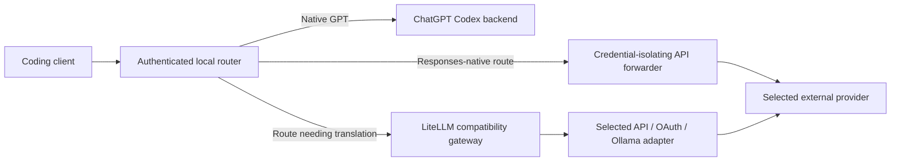

# Codex Router

English · [简体中文](README.zh-CN.md) · [日本語](README.ja.md)

Use external models in Codex and other coding clients through one local router.
Store provider credentials locally, share one installation across
clients, and keep native GPT access when you have a valid ChatGPT login.

[Install](#install) · [First use](#first-use) · [Providers](#providers-and-models) ·
[Commands](#common-commands) · [Documentation](#documentation)

## What it supports

| Client | Integration |
| --- | --- |
| Codex App and CLI | Native and external models in the model picker; Linux support covers the CLI |
| DeepSeek Harness | Managed provider routes in its settings |
| Gemini CLI | Managed endpoint, key, and default-model environment block |
| Cursor Agent / Cursor App | Local Agent launcher / separately keyed public HTTPS edge for App BYOK |
| Claude Code | Separate `claude-router` launcher using the local Messages adapter |
| OpenClaw | Managed Responses provider |
| opencode, pi, omp, Command Code, Hermes Agent | Provider configuration published into the existing client |

The Control Center manages connections, model visibility, usage, and service
health. macOS uses a native menu-bar host with an embedded Electron window;
Windows and Linux use an Electron window and tray.

Image, search, and subagent capabilities depend on the selected model route.
Some features use additional provider requests and quota. See the [Codex guide](docs/CODEX.md) and
[client guide](docs/COMPATIBLE-APPS.md) for limitations.

## Install

### Requirements

- Codex App or CLI for the default Codex setup; install another supported client
  when using its integration.
- Node.js 22.19+; a maintained Node.js 24 LTS release is recommended.
- Git for managed checkout installation, updates, and rollback.
- `uv` or Python 3.10+ with `venv` for the default compatibility-enabled source
  installation. An explicit [compatibility-layer opt-out](docs/compatibility-layer.md)
  skips Python installation and probes. Source dependency setup follows the
  stored compatibility policy. Homebrew installs the formula's Python dependencies.
- On Windows, PowerShell must run in `FullLanguage` mode and policy must allow
  `Add-Type`.
- To build the macOS desktop companion locally, the full Xcode app is required.

Choose one installation method. Setup asks which providers to enable and uses
private local prompts for credentials. Live inference tests run only when
explicitly requested and consume the selected provider's quota.

### Guided source installation

**macOS / Linux — Terminal**

```sh
curl -fsSL https://raw.githubusercontent.com/duolahypercho/codex-router/main/install.sh \
  | sh -s -- --target codex --guided --with-tray
```

**Windows — PowerShell**

```powershell
$installer = Join-Path $env:TEMP "codex-router-install.ps1"
Invoke-WebRequest https://raw.githubusercontent.com/duolahypercho/codex-router/main/install.ps1 -OutFile $installer
powershell.exe -NoProfile -ExecutionPolicy Bypass -File $installer -Target codex -Guided -WithTray
```

These commands install the router service and desktop companion. Use `--no-tray`
(macOS/Linux) or `-NoTray` (Windows), in place of the tray flag, for the router
without the companion. On macOS, a missing full Xcode installation skips the
companion with guidance rather than failing the installed router.

To inspect the installer first, clone the repository and run the local
installer. See [installation, proxy configuration, and migration](docs/INSTALL.md).

### Homebrew — router and CLI only

```sh
brew tap duolahypercho/codex-router https://github.com/duolahypercho/codex-router
brew install codex-router
codex-router setup --guided
```

Homebrew provides the router and CLI; use the source installer for the desktop
companion. Use `codex-router <command>` for the Codex maintenance commands below, and
`brew upgrade codex-router` for updates. See the
[Homebrew instructions](docs/INSTALL.md#homebrew-router-and-cli-only) for command
equivalents and removal.


## First use

1. Finish provider setup. Some providers require you to select models from their
   live catalog before any appear.
2. Run the doctor from the installed checkout and resolve any `FAIL`:
   `./bin/model-router codex doctor` on macOS/Linux, or
   `.\model-router.ps1 codex doctor` on Windows.
3. Fully quit and reopen Codex, create a new task, and choose the intended model.
   Codex reads the router's model catalog at startup.
4. Open **Codex Router** for the Control Center. Closing its window normally
   leaves the tray running; use its tray/menu-bar entry to reopen it.

If a model is missing, check provider selection, authentication, and model
visibility before reinstalling. See
[missing models](docs/TROUBLESHOOTING.md#external-models-are-missing-from-the-picker).
A native GPT model additionally requires a usable ChatGPT login.

For agent-assisted installation, give your agent the repository link and ask
it to follow [AGENTS.md](https://github.com/duolahypercho/codex-router/blob/main/AGENTS.md), preserve existing settings and login,
use only your chosen providers, run the doctor, and leave the final Codex
restart to you.

## Providers and models

Built-in integrations include Anthropic, Kimi, DeepSeek, xAI, Z.ai, Qwen,
MiniMax, Meta, OpenRouter, GitHub Copilot, and others. Available models depend
on the provider, region, account entitlement, and your local selection.

For example, from a source checkout on macOS/Linux:

```sh
./bin/model-router codex provider-key deepseek set
./bin/model-router codex providers enable deepseek
./bin/model-router codex providers
```

On Windows, replace `./bin/model-router codex` with
`.\model-router.ps1 codex`. For catalog-only providers, select models with
`./bin/curate-models PROVIDER` on macOS/Linux or
`.\codex-router.ps1 curate-models PROVIDER` on Windows.

- API services, chat/coding subscriptions and regional platforms each follow
  their own authentication, entitlement and billing.
- Verify locally curated models against the intended client and tool workflow.
- Anonymous and custom endpoints require your explicit selection. Their operators
  receive the prompts sent to those routes.
- Native GPT traffic uses the ChatGPT Codex backend by default; optional native
  redirection and login-free modes change that behavior.

See [providers, authentication, and curation](docs/PROVIDERS.md),
[Codex modes and optional features](docs/CODEX.md), and the
[model registry](https://github.com/duolahypercho/codex-router/tree/main/config/).

## Common commands

Run these from the installed source checkout. Commands that update, repair,
stop, or remove the service can interrupt routed conversations.

| Action | macOS / Linux | Windows PowerShell |
| --- | --- | --- |
| Diagnose | `./bin/model-router codex doctor` | `.\model-router.ps1 codex doctor` |
| Service status | `./bin/model-router codex status` | `.\model-router.ps1 codex status` |
| Start service | `./bin/model-router codex start` | `.\model-router.ps1 codex start` |
| Stop service | `./bin/model-router codex stop` | `.\model-router.ps1 codex stop` |
| Check for update | `./bin/model-router codex update check` | `.\model-router.ps1 codex update check` |
| Update | `./bin/model-router codex update` | `.\model-router.ps1 codex update` |
| Roll back source | `./bin/model-router codex rollback` | `.\model-router.ps1 codex rollback` |
| Remove integration | `./bin/model-router codex uninstall` | `.\model-router.ps1 codex uninstall` |

Updates preserve a previous source revision for rollback and require a recognized
managed checkout. They refuse to replace tracked edits without explicit
`--force`. Homebrew users update with `brew upgrade codex-router`.
Uninstall retains credentials, logs, and recovery data; it retires the shared
service only when no client integration still uses it. See
[updates and removal](docs/INSTALL.md#update-and-rollback).

## How requests are routed



LiteLLM handles routes that require protocol translation.
The runtime starts downstream services required by the selected routes.
The default source installer still provisions Python while compatibility is
enabled; an [explicit opt-out](docs/compatibility-layer.md) persists across
supported updates and repairs and makes gateway-dependent routes unavailable.

Router listeners bind to loopback. Cursor App is a special case: retail BYOK
requires a stable public HTTPS tunnel to its separate app-only edge; do not
expose the main router endpoint. Local caller capabilities are secrets, so
do not share complete managed URLs.

The client still runs tools and enforces permissions. The router routes inference,
adapts protocols, and applies its configured history policies. See [architecture](docs/HOW-IT-WORKS.md)
and [security](SECURITY.md).

## Documentation

| Need | Guide |
| --- | --- |
| Install, migrate, configure a proxy, update, or remove | [Installation](docs/INSTALL.md) |
| Connect a provider or curate models | [Providers and models](docs/PROVIDERS.md) |
| Configure Codex, archive readback, vision, or failover | [Codex guide](docs/CODEX.md) |
| Connect another coding client | [Compatible clients](docs/COMPATIBLE-APPS.md) |
| Manage the desktop app | [Desktop app](docs/DESKTOP-TRAY.md) · [macOS tray and widget](docs/MACOS-TRAY.md) |
| Use local models | [Local LLMs](docs/LOCAL-MODELS.md) |
| Diagnose a failure | [Troubleshooting](docs/TROUBLESHOOTING.md) |
| Understand routing and credentials | [Architecture](docs/HOW-IT-WORKS.md) · [Security](SECURITY.md) |
| Develop providers or translations | [Development](docs/DEVELOPMENT.md) · [Interface localization](docs/LOCALIZATION.md) |
| Review releases | [Changelog](CHANGELOG.md) |

The homepages and companion guides are available in English, Simplified
Chinese, and Japanese. Update corresponding pages together; preserve commands,
configuration keys, model IDs, and link targets when translating.

Codex Router is an independent community project. MIT licensed; see [LICENSE](LICENSE)
and [NOTICE.md](NOTICE.md).
