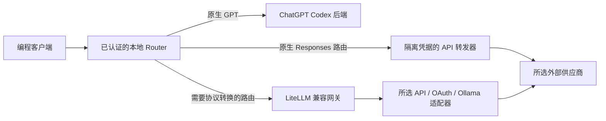

# Codex Router

[English](README.md) · 简体中文 · [日本語](README.ja.md)

通过一个本地路由器，在 Codex 和其他编程客户端中使用外部模型。
供应商密钥保存在本机，多种客户端共用一套安装；
拥有有效 ChatGPT 登录时，也可以保留原生 GPT 访问。

[安装](#安装) · [首次使用](#首次使用) · [供应商](#供应商与模型) ·
[常用命令](#常用命令) · [文档](#文档)

## 支持什么

| 客户端 | 接入方式 |
| --- | --- |
| Codex App 和 CLI | 在模型菜单中使用原生及外部模型；Linux 支持 CLI |
| DeepSeek Harness | 在设置文件中写入受管理的供应商路由 |
| Gemini CLI | 写入受管理的端点、密钥和默认模型环境变量块 |
| Cursor Agent / Cursor App | Agent 使用本地启动器；App BYOK 使用独立密钥保护的公网 HTTPS 入口 |
| Claude Code | 通过单独的 `claude-router` 启动器接入本地 Messages 适配器 |
| OpenClaw | 写入受管理的 Responses 供应商配置 |
| opencode、pi、omp、Command Code、Hermes Agent | 向现有客户端写入供应商配置 |

控制中心用于管理连接、模型可见性、用量和服务健康状态。
macOS 使用原生菜单栏宿主并内嵌 Electron 窗口；
Windows 和 Linux 使用 Electron 窗口与托盘。

图片、搜索和子代理能力取决于所选模型路由，部分功能会额外调用供应商并消耗额度。
限制详见 [Codex 指南](docs/zh-CN/CODEX.md)和[客户端指南](docs/zh-CN/COMPATIBLE-APPS.md)。

## 安装

### 环境要求

- 默认 Codex 安装需要 Codex App 或 CLI；接入其他客户端时需要安装相应客户端。
- Node.js 22.19+；建议使用仍受维护的 Node.js 24 LTS 版本。
- 受管理的源码安装、更新和回退需要 Git。
- 默认开启兼容层的源码安装需要 `uv`，或带 `venv` 的 Python 3.10+。
  显式[停用兼容层](docs/zh-CN/compatibility-layer.md)后，安装器才会跳过 Python 安装与探测；
  源码依赖安装遵循保存的兼容层配置。Homebrew 会安装配方声明的 Python 依赖。
- Windows PowerShell 必须运行在 `FullLanguage` 模式，且系统策略允许 `Add-Type`。
- 在 macOS 本机构建桌面配套应用需要完整 Xcode，单独的 Command Line Tools 不足以构建。

选择一种安装方式即可。安装过程会询问要启用的供应商，并通过本机私密提示输入凭据。
实时推理测试按明确选择运行，并消耗所选供应商的额度。

### 引导式源码安装

**macOS / Linux — 终端**

```sh
curl -fsSL https://raw.githubusercontent.com/duolahypercho/codex-router/main/install.sh \
  | sh -s -- --target codex --guided --with-tray
```

**Windows — PowerShell**

```powershell
$installer = Join-Path $env:TEMP "codex-router-install.ps1"
Invoke-WebRequest https://raw.githubusercontent.com/duolahypercho/codex-router/main/install.ps1 -OutFile $installer
powershell.exe -NoProfile -ExecutionPolicy Bypass -File $installer -Target codex -Guided -WithTray
```

以上命令安装 Router 服务和桌面配套应用。如果只需要 Router，
用 `--no-tray`（macOS/Linux）或 `-NoTray`（Windows）替换对应的托盘参数。
macOS 未安装完整 Xcode 时，安装器会给出提示并跳过桌面配套应用。

如果希望先检查安装脚本，可以克隆仓库后运行本地安装器。
详见[安装、代理配置与迁移](docs/zh-CN/INSTALL.md)。

### Homebrew — 仅 Router 与 CLI

```sh
brew tap duolahypercho/codex-router https://github.com/duolahypercho/codex-router
brew install codex-router
codex-router setup --guided
```

Homebrew 提供 Router 与 CLI；桌面配套应用通过源码安装器安装。
执行下方 Codex 维护操作时使用 `codex-router <command>`；
更新使用 `brew upgrade codex-router`。
命令对应关系与卸载步骤见 [Homebrew 说明](docs/zh-CN/INSTALL.md#homebrew-router-and-cli-only)。


## 首次使用

1. 完成供应商设置。部分供应商需要先从实时目录中选择模型，菜单里才会出现模型。
2. 在已安装的源码目录运行诊断，处理所有 `FAIL`：
   macOS/Linux 使用 `./bin/model-router codex doctor`；
   Windows 使用 `.\model-router.ps1 codex doctor`。
3. 完全退出并重新打开 Codex，新建任务后选择目标模型。
   Codex 在启动时读取 Router 模型目录。
4. 打开 **Codex Router** 进入控制中心。关闭窗口后，托盘通常会继续运行；
   可从托盘或菜单栏重新打开窗口。

如果模型没有出现，先检查供应商是否启用、认证是否有效、模型是否可见，
不要立即重装。详见[模型菜单缺少外部模型](docs/zh-CN/TROUBLESHOOTING.md#external-models-are-missing-from-the-picker)。
原生 GPT 模型还需要可用的 ChatGPT 登录。

如需让代理协助安装，把仓库链接交给它，并要求它遵循 [AGENTS.md](https://github.com/duolahypercho/codex-router/blob/main/AGENTS.md)，
保留现有设置和登录，只使用你选择的供应商，运行诊断，
最后由你自己重启 Codex。

## 供应商与模型

内置接入包括 Anthropic、Kimi、DeepSeek、xAI、Z.ai、Qwen、MiniMax、
Meta、OpenRouter、GitHub Copilot 等。
具体可用模型取决于供应商、地区、账户权限和本机选择。

例如，在 macOS/Linux 的源码目录运行：

```sh
./bin/model-router codex provider-key deepseek set
./bin/model-router codex providers enable deepseek
./bin/model-router codex providers
```

Windows 将 `./bin/model-router codex` 替换为 `.\model-router.ps1 codex`。
对于不预选模型的供应商，macOS/Linux 使用 `./bin/curate-models PROVIDER`
选择模型，Windows 使用 `.\codex-router.ps1 curate-models PROVIDER`。

- API 服务、聊天/编程订阅和地区平台各自使用对应的认证、权限与账单。
- 本机添加模型后，按目标客户端和工具流程验证实际行为。
- 匿名服务和自定义端点需要你明确选择；发送到这些路由的提示会交给相应服务运营方。
- 默认情况下，原生 GPT 请求使用 ChatGPT Codex 后端；
  可选的原生模型重定向与免登录模式会改变这一行为。

详见[供应商、认证与模型选择](docs/zh-CN/PROVIDERS.md)、
[Codex 模式与可选功能](docs/zh-CN/CODEX.md)以及[模型注册表](https://github.com/duolahypercho/codex-router/tree/main/config/)。

## 常用命令

以下命令应在已安装的源码目录中运行。
更新、修复、停止或移除服务等操作可能中断正在通过 Router 运行的对话。

| 操作 | macOS / Linux | Windows PowerShell |
| --- | --- | --- |
| 诊断 | `./bin/model-router codex doctor` | `.\model-router.ps1 codex doctor` |
| 服务状态 | `./bin/model-router codex status` | `.\model-router.ps1 codex status` |
| 启动服务 | `./bin/model-router codex start` | `.\model-router.ps1 codex start` |
| 停止服务 | `./bin/model-router codex stop` | `.\model-router.ps1 codex stop` |
| 检查更新 | `./bin/model-router codex update check` | `.\model-router.ps1 codex update check` |
| 更新 | `./bin/model-router codex update` | `.\model-router.ps1 codex update` |
| 回退源码版本 | `./bin/model-router codex rollback` | `.\model-router.ps1 codex rollback` |
| 移除接入 | `./bin/model-router codex uninstall` | `.\model-router.ps1 codex uninstall` |

更新会保留上一个源码版本供回退，并要求使用可识别的受管理仓库。
存在已跟踪文件修改时，除非明确使用 `--force`，否则更新不会覆盖这些修改。
Homebrew 用户通过 `brew upgrade codex-router` 更新。
卸载会保留凭据、日志和恢复数据；只有不再有客户端接入使用共享服务时，才会移除该服务。
详见[更新与移除](docs/zh-CN/INSTALL.md#update-and-rollback)。

## 请求如何路由



LiteLLM 负责需要协议转换的路由。
运行时按所选路由启动所需的下游服务。
默认源码安装器在兼容层开启时仍会准备 Python；
[显式停用](docs/zh-CN/compatibility-layer.md)后，这项选择会跨受支持的更新和修复保留，
依赖网关的路由也会变得不可用。

Router 监听本机回环地址。Cursor App 是例外场景：
零售版 BYOK 需要稳定的公网 HTTPS 隧道，连接到独立的 App 专用入口，
不要暴露主 Router 端点。本地调用凭据属于秘密，不要分享完整的受管理 URL。

工具仍由客户端执行，权限仍由客户端控制。
Router 负责推理路由、协议适配及已配置的历史处理，
详见[架构](docs/zh-CN/HOW-IT-WORKS.md)与[安全说明](SECURITY.zh-CN.md)。

## 文档

| 需求 | 指南 |
| --- | --- |
| 安装、迁移、代理、更新或移除 | [安装指南](docs/zh-CN/INSTALL.md) |
| 连接供应商或选择模型 | [供应商与模型](docs/zh-CN/PROVIDERS.md) |
| 配置 Codex、归档回读、图片桥接或额度故障转移 | [Codex 指南](docs/zh-CN/CODEX.md) |
| 接入其他编程客户端 | [兼容客户端](docs/zh-CN/COMPATIBLE-APPS.md) |
| 管理桌面应用 | [桌面应用](docs/zh-CN/DESKTOP-TRAY.md) · [macOS 托盘与小组件](docs/zh-CN/MACOS-TRAY.md) |
| 使用本地模型 | [本地模型](docs/zh-CN/LOCAL-MODELS.md) |
| 排查故障 | [故障排查](docs/zh-CN/TROUBLESHOOTING.md) |
| 理解路由与凭据边界 | [架构](docs/zh-CN/HOW-IT-WORKS.md) · [安全说明](SECURITY.zh-CN.md) |
| 开发供应商接入或参与翻译 | [开发指南](docs/zh-CN/DEVELOPMENT.md) · [界面本地化](docs/zh-CN/LOCALIZATION.md) |
| 查看版本变化 | [更新日志](CHANGELOG.md) |

首页和配套指南提供英文、简体中文与日文版本。修改文档时同步对应语言页面；
翻译时保持命令、配置键、模型 ID 和链接目标原样。

Codex Router 是独立社区项目。
采用 MIT 许可证，详见 [LICENSE](LICENSE) 与 [NOTICE.md](NOTICE.md)。
