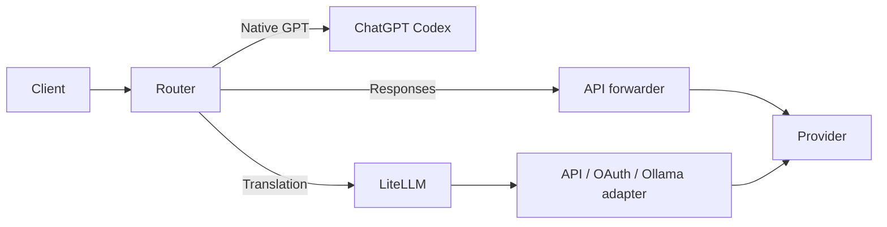

# Router の仕組み

[English](../HOW-IT-WORKS.md) · [简体中文](../zh-CN/HOW-IT-WORKS.md) · 日本語

Router はクライアントのプロトコル、モデルルート、プロバイダー認証をつなぎます。Codex、ほかの CLI、デスクトップクライアントはローカルプレーンを共有し、ツール実行と権限は各クライアントが担当します。

## リクエスト経路

ネイティブ GPT は通常 ChatGPT Codex、Responses ネイティブルートは API 転送器、Chat/メッセージ/Vertex/OAuth/Ollama などの変換ルートは LiteLLM を通ります。明示的なネイティブリダイレクト、ログインモード、モデル端点の上書きは実経路に反映されます。

実行時は[実行計画](route-execution-plan.md)から必要なサービスを起動します。Python の準備は永続化された[互換レイヤー設定](compatibility-layer.md)に従います。

## レジストリとカタログ

`config/` はモデルとプロバイダーを定義し、ローカルオーバーレイは手動選択を保存します。`enabled-providers.json` は有効化、`model-picker.json` は表示と順序を管理します。各クライアントへの公開は同じ選択を使います。

ネイティブカタログは Codex のメタデータを保持し、外部モデルは現行 schema に独自の名前と機能を載せます。ログイン時は実際のアカウントカタログを使います。ログイン不要モードはクライアントが許可するネイティブ slug に外部モデルを対応付けられ、内部経路には正規 slug を保持します。

## 認証とネットワーク

ローカル呼び出し用と内部サービス用のキーは別々に生成します。API 転送器は最後のホップでプロバイダー認証を付与します。外部モデルはその端点とアカウント認証を使います。Copilot はアカウントを検証してから許可された GitHub inference ホストに送ります。

Router はループバックで待ち受け、Cursor App の専用 BYOK edge は専用公開 HTTPS トンネルから接続できます。モデル探索と汎用端点では DNS、リダイレクト、応答サイズ、認証スコープを検証します。[セキュリティモデル](../../SECURITY.ja.md)を参照してください。

## プロトコル変換と検索

リクエスト profile はプロバイダー固有の推論、ツール、メッセージ制約を処理します。同じモデルでも提供先で機能が異なります。`searchTool` は検証済みの検索経路、`supportsSearchHistory` は保存済み検索履歴の読取を宣言します。Perplexity サイドカーはモデル単位で明示的に関連付けます。

## WebSocket とストリーム

クライアント WebSocket は呼び出しキー検証後に upgrade し、`response.create` を受け、差分履歴を復元して同じ HTTP Responses 経路に入ります。上流の Responses WebSocket は認証を所有する転送器が管理し、端点と handshake の識別情報で接続を分離します。

接続確立前の失敗は対応する規則で HTTP に戻せます。要求送信後は明示的なストリーム状態に従います。出力側の環境プロキシ利用時は raw socket WebSocket の経路に制約があります。キャンセル、期限、下流の backpressure は処理チェーンに伝えます。

## コンテキストと原文保存

外部モデルの圧縮 checkpoint は Router の `kcr2:` 形式で、検証済みソース ID、利用者の要件、ツール要求、返却された証拠を記録します。有界かつ損失のある履歴表現であり、可変状態には新しい観測が必要です。ネイティブ OpenAI の不透明な圧縮項目はネイティブ経路で扱います。

ツール結果のエージングは別の任意設定です。原文保存とローカルアクセスの証明が成功した後に対象出力を省略します。読取、有効期限、検索は [Codex ガイド](CODEX.md)にあります。

## サブエージェントとクライアント機能

外部モデルのサブエージェント機能は検証済みルートで公開します。Codex の暗号化された委派内容は必要に応じて認証済みネイティブリレーで展開するため、有効な ChatGPT ログインとネイティブ利用枠を使います。カタログ、管理対象のエージェント定義、メニュー、ランタイムの整合性を保ちます。
