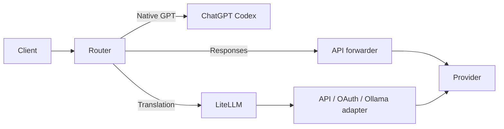

# Router 的工作方式

[English](../HOW-IT-WORKS.md) · 简体中文 · [日本語](../ja/HOW-IT-WORKS.md)

Router 将客户端协议、模型路由和供应商认证连接在一起。Codex、其他 CLI 和桌面客户端共用本地平面；工具执行和权限由相应客户端处理。

## 请求路径

原生 GPT 通常走 ChatGPT Codex，Responses 原生路由经 API 转发器，Chat/消息/Vertex/OAuth/Ollama 等需要转换的路由经 LiteLLM。明确的原生重定向、登录模式和模型端点覆层会影响实际路由。

运行时按[执行计划](route-execution-plan.md)启动所需服务。安装器是否准备 Python，取决于持久的[兼容层设置](compatibility-layer.md)。

## 注册表和模型目录

`config/` 定义模型和供应商；本机覆层保存手动选择。`enabled-providers.json` 管理供应商启用，`model-picker.json` 管理模型显示和排序。目录发布给各客户端时共用这套选择。

原生目录保留 Codex 元数据，外部模型采用当前客户端 schema 并使用自己的身份和能力。登录模式下目录来自真实账户；免登录模式可按客户端允许的原生 slug 生成外部模型映射，规范 slug 仍用于内部路由。

## 认证与网络

本地调用凭据与内部服务密钥分别生成。API 转发器在最后一跳加入相应供应商凭据；外部模型使用其端点和账户认证。Copilot 先验证账户，再按受限的 GitHub inference 主机发送。

Router 监听回环地址；Cursor App 的独立 BYOK edge 可通过专用公网 HTTPS 隧道接入。模型发现和通用端点对 DNS、重定向、响应大小及凭据范围做验证。详见[安全模型](../../SECURITY.zh-CN.md)。

## 协议适配和搜索

请求 profile 处理供应商特有的推理、工具和消息约束。相同模型在不同平台可有不同能力。`searchTool` 声明已验证的搜索路线，`supportsSearchHistory` 声明对已有搜索历史的读取支持。Perplexity 侧车按具体模型显式绑定。

## WebSocket 与流

客户端 WebSocket 在验证本地调用凭据后升级，接收 `response.create`，恢复增量历史后进入同一 HTTP Responses 路径。上游 Responses WebSocket 由凭据所属转发器管理，按端点和握手身份隔离连接。

连接建立前失败可按现有协议回退 HTTP；请求已发送后按明确的流状态处理。带出站环境代理时，原始 socket WebSocket 路径受到相应限制。客户端取消、超时和下游背压会传递到处理链。

## 上下文与原文保存

外部模型的压缩 checkpoint 使用 Router 管理的 `kcr2:` 格式，记录经验证的源 ID、用户约束、调用请求和工具返回证据。它是有界且有损的历史表示；可变状态需要再次观察。原生 OpenAI 的不透明压缩项按其原生路径处理。

工具结果老化是另一项可选设置。原文成功保存且本地访问证明有效后，才省略符合条件的输出。读取、过期和搜索的边界见[Codex 指南](CODEX.md)。

## 子代理和客户端能力

外部模型的子代理能力按经过验证的路由发布。Codex 的加密委派载荷在需要时由已认证的原生中继展开；这部分依赖有效 ChatGPT 登录与原生额度。目录、受管理代理定义、菜单选择和运行时保持一致。
